<p align="center">
  
</p>

<h1 align="center">Orb</h1>

<p align="center">
  <strong>A fluid, liquid-glass Dynamic Island & Notch Companion designed natively for your MacBook notch.</strong>
</p>

<p align="center">
  <a href="https://github.com"></a>
  <a href="https://github.com"></a>
  <a href="https://developer.apple.com/swift/"></a>
  <a href="https://developer.apple.com/metal/"></a>
  <a href="https://github.com"></a>
  <a href="LICENSE"></a>
</p>

---

## 🌟 Highlights

Orb transforms the static black camera notch on your MacBook Pro or MacBook Air into an elegant, interactive **Dynamic Island** with real-time Apple Music synchronized karaoke lyrics, native calendar schedule integration, liquid glass refraction, and an adorable **Animated Notch Pet Companion** featuring 5 unique pets, a 19-piece wardrobe boutique, live feeding snacks, and music-reactive behaviors!

<p align="center">
  <a href="dist/Orb-v1.03.dmg">
    
  </a>
</p>

---

## ✨ Features

### 🐾 Animated Notch Pet Companion
- **5 Lovable Companions**:
  - 🐱 **Cat (Mochi)**: Playful feline with swishing tail, almond eyes, and pink inner ears.
  - 🐶 **Dog (Bento)**: Enthusiastic puppy that wags its tail and pants happily.
  - 🦆 **Duck (Waddles)**: Fluffy duckling with flapping wings and waddling webbed feet.
  - 🕷️ **Spider (Webby)**: Notch acrobat designed specifically for the MacBook bezel—hangs from a delicate silver silk bungee thread and crawls on 8 articulated legs!
  - 🔮 **Orb (Lumi)**: Dynamic glowing holographic sphere with orbiting crystalline rings.
- **🎧 Mini DJ Headphones**: Auto-wears glowing neon headphones that bob with the music waveform when audio plays.
- **🎤 Karaoke Singing Lip-Sync**: Opens its mouth and sings with floating musical notes in sync with Apple Music vocal phrases, resting during instrumental breaks.
- **💃 Adaptive Dance Routines**: Automatically picks energetic bouncy dance moves for upbeat tempos vs. gentle sways for slow acoustic songs.
- **⚡ MagSafe Battery Snack**: Holds a glowing golden lightning bolt or battery snack with electric sparks whenever your MacBook is connected to power.
- **💻 Rapid Typing / Work Companion**: Pulls out a glowing miniature laptop or cheers with pom-poms whenever you type rapidly while coding or writing.
- **⏳ Pomodoro Break & Hydration Reminder**: Yawns, stretches, and prompts a quick water break every 45–60 minutes of continuous focus.
- **🌦 Weather Reaction Wardrobe**: Automatically equips a yellow raincoat & boots in rain, warm winter beanie & scarf in cold/snow, or sunglasses on sunny days.
- **🍕 Interactive Feeding Station**: Feed your pet delicious treats (Fish 🐟, Bone 🦴, Bread 🍞, Fly 🪰, Star Candy ⭐) with real-time fullness and happiness meters and `"nom nom nom!"` animations.
- **👗 19-Piece Wardrobe Boutique**: 11 hats (DJ Headphones, Sunglasses, Rain Hat, Winter Beanie, Party Hat, Crown, Chef Toque, Fedora, Wizard Hat, Sunhat, Gamer Headset) and 8 outfits (Raincoat, Winter Sweater, Tuxedo, Hero Cape, Hawaiian Shirt, Dino Onesie, Space Suit).

### 🏝️ Fluid Dynamic Island
- **Seamless Notch Hugging**: Hugs your MacBook's physical notch and expands smoothly with organic spring physics on hover or track changes.
- **Sub-Pixel Hardware Calibration**: Width and height offset adjustments to perfectly calibrate to any 13", 14", 15", or 16" MacBook display.
- **Dynamic Liquid Glass Refraction**: Optical shader refraction and progressive multi-stage blurs that blend album artwork into macOS menu bars.

### 🎵 Real-Time Synced Karaoke Lyrics
- **Sneak Peek Below Notch**: Stream synchronized karaoke lyrics in real time directly below the notch in compact mode.
- **Apple Music Character Glow Sweep**: Syllable reveals and vocal phrase illumination directly in the expanded island.
- **Intro & Instrumental Pulsing Dots**: Musical pulsing indicators (`• • •`) preview upcoming lyrics during instrumental breaks.
- **Live Sync Offset Tuning**: Adjustable synchronization offset (-3.0s to +3.0s) in Settings with a single-click reset.

### 🎛️ Symmetrical Centered Playback Controls
- **Dead-Center Controls**: `[Previous]`, `[Play/Pause]`, and `[Next]` are locked directly in the center of the expanded notch.
- **Utility Flanking**: Quick-favorite star on the left, interactive queue drawer on the right.
- **Universal Player Detection**: Seamlessly detects Apple Music, Spotify, and system Now Playing audio.

### 📅 Interactive Week Calendar
- **Clickable Week Strip**: Click any day of the week to inspect scheduled events with illuminated accent glows.
- **One-Click Event Launch**: Clicking an event opens Apple Calendar directly to that exact meeting date view.
- **Live Countdown Badges**: Real-time status tags (`"Now"`, `"in 15m"`, `"Tomorrow 10:00 AM"`).
- **Quick Launch**: Header shortcut to jump straight into Calendar.app.

---

## 🏗️ Repository Architecture

Orb is organized into clean, modular Swift domains:

```
Orb/
├── Pet/
│   ├── PetModels.swift           # NotchPetType, PetHat, PetOutfit, PetTreat, PetAction enums
│   ├── NotchPetManager.swift     # Autonomous brain (IOKit, typing companion, Pomodoro, sleep)
│   ├── NotchPetRenderer.swift    # High-fidelity vector sprites & 3D shaded pet characters
│   ├── NotchPetWardrobe.swift    # 19 custom-fitted hats, outfits, DJ headphones, laptops, battery snacks
│   └── NotchPetView.swift        # Notch anchor positioning, silk bungee, speech bubbles & treat drops
├── Views/
│   ├── OrbNotchView.swift        # Main Dynamic Island container & alignment coordinator
│   ├── IslandBackground.swift    # Liquid glass shaders, NSGlassEffectView, motion artwork looper
│   ├── MusicPlayerView.swift     # Symmetrical centered player, Compact & Now Playing panels, waveforms
│   ├── LyricsView.swift          # LRCLIB synced karaoke lyrics, syllable glow sweep, intro dots
│   └── CalendarView.swift        # Interactive clickable 7-day strip & meeting deep links
├── Settings/
│   └── PetSettingsTab.swift      # Dedicated Notch Pet companion settings & feeding station
├── ContentView.swift             # 6-tab settings window & preference bindings
├── OrbApp.swift                  # NSPanel lifecycle, hover monitors & activation policy
└── Orbstate.swift                # Playback state, audio detection & EventKit store
```

---

## 📦 Installation & Download

### Option 1: Download Pre-Built DMG (Recommended)
1. Download **[`Orb-v1.03.dmg`](dist/Orb-v1.03.dmg)** or grab the latest release from the [Releases](https://github.com) page.
2. Open the DMG and drag **Orb.app** into your **Applications** folder.
3. Launch Orb. Click the menu bar icon (`Orb`) and select **Settings...** (`⌘,`) to customize your preferences.

> **Note on macOS Gatekeeper**: Because this is an open-source build, right-click `Orb.app` and select **Open** the first time, or grant permission in *System Settings > Privacy & Security*.

---

### Option 2: Build From Source

#### Prerequisites
- macOS 13.0 (Ventura) or later
- Xcode 15.0 or later
- Command Line Tools installed (`xcode-select --install`)

#### One-Line Build Script
Clone the repository and run the automated release builder:

```bash
git clone https://github.com/thepilot2003/Orb.git
cd Orb
chmod +x build_release.sh
./build_release.sh
```

The script compiles the application, ad-hoc codesigns it, and generates:
- `dist/Orb.app` (Ready to run)
- `dist/Orb-v1.03.dmg` (Installer disk image)
- `dist/Orb-v1.03-macOS.zip` (Zip archive)

---

## 🔒 Permissions & Privacy

Orb is privacy-first and open source. All processing happens 100% locally on your Mac:

| Permission | Purpose |
| :--- | :--- |
| **Automation (Apple Events)** | Communicates locally with Apple Music and Spotify to display song title, artist, playback progress, and controls. |
| **Calendars (EventKit)** | Reads upcoming local calendar entries to display meeting countdowns in the idle island. No calendar data is ever uploaded. |
| **Screen Capture (Optional)** | Orb includes a privacy toggle to automatically hide itself from screen recordings and screenshots. |

---

## 🤝 Contributing

Contributions, bug reports, and feature requests are welcome! See [`CONTRIBUTING.md`](CONTRIBUTING.md) and [`CHANGELOG.md`](CHANGELOG.md) for guidelines.

---

## 📄 License

Distributed under the **MIT License**. See [`LICENSE`](LICENSE) for more information.

<p align="center">
  <sub>Crafted with ❤️ for the Mac community.</sub>
</p>
